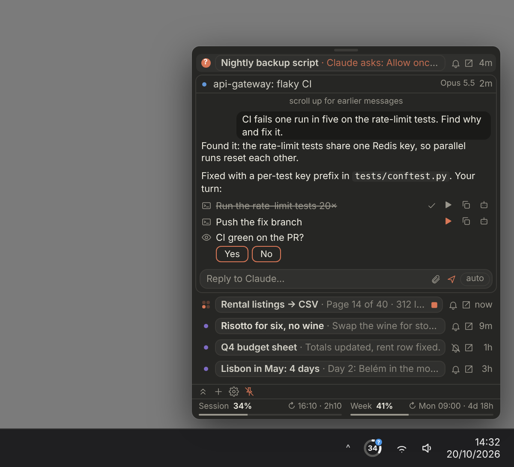
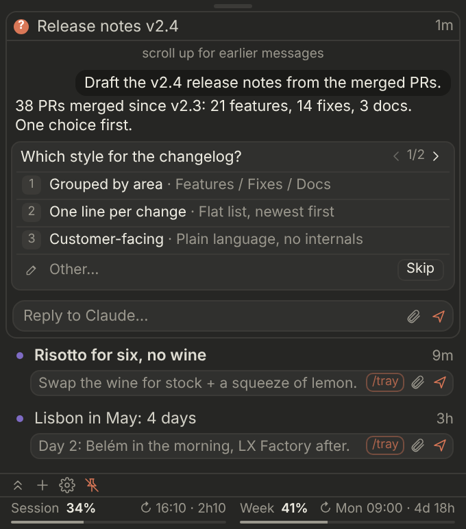
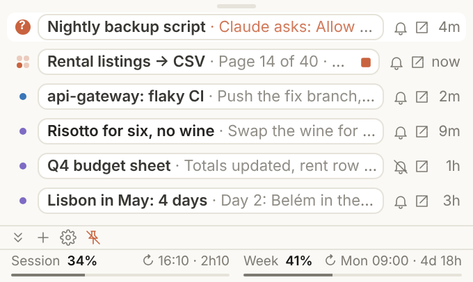

# Tray for Claude

A Windows tray panel for your Claude chats and plan usage.



Preview release (0.2.x). It works, but things still change between versions. Bug reports are welcome.

## Features

- Your chats in a list, each with its own reply box. Open one to read the conversation, reply, stop or retry,
  and send or open files.
- Steps you can run from the panel. In chats started with `/tray`, Claude adds the commands it wants you to run.
  You run them in one click, and the output goes back to Claude when you send "check".
- Permission prompts and Claude Code questions can be answered from the panel. The chat and the tray icon show
  a "?" while Claude is waiting for you.
- Session and weekly usage, with a notification at 80 % and 95 %.

<p>
  
  
</p>

## Install

1. Download or clone this repository to a folder you can write to, for example `C:\Tools\ClaudeTray`.
2. In PowerShell, from that folder:

   ```powershell
   powershell -NoProfile -ExecutionPolicy Bypass -File .\ClaudeTray.ps1 -WebLogin
   ```

   A browser window opens on claude.ai. Sign in and close it. The icon then appears next to the clock and the
   tray starts with Windows.
3. Optional, for steps: upload `skill/tray.zip` as a skill in Claude and start a chat with `/tray`. The `/tray`
   chip in the panel adds it to your next message.

Needs Windows 10 (1809 or later) or Windows 11, Edge and the WebView2 runtime (both come with Windows), and a paid
Claude plan. No installer and no admin rights.

## Shortcuts

| Action | How |
| --- | --- |
| Show or hide the panel | Click the tray icon |
| Open the Claude app | Double-click the tray icon |
| Collapse or expand all chats | Click the grip at the top |
| Move the panel | Drag the grip. It stays where you leave it. |
| Keep it on top | Pin button, bottom left |
| Resize, zoom | Drag an edge, Ctrl + mouse wheel |
| Send, new line | Enter, Shift + Enter |
| Slash commands | Type `/` in a reply box |
| Attach files | Paste, drop, or use the clip button |
| Pin, move, hide a chat, open it on claude.ai | Right-click its title |
| One line per chat | Settings > Compact mode |

## Commands

Run them as `powershell -NoProfile -ExecutionPolicy Bypass -File .\ClaudeTray.ps1 <command>`.

| Command | What it does |
| --- | --- |
| `-WebLogin` | Signs the tray's browser in to claude.ai, then starts the tray. |
| (none), `-Restart` | Starts or restarts the tray in the background. |
| `-QuestRoot <folder>` | Sets the folder shared with Claude for steps and results (optional). |
| `-Install`, `-Uninstall` | Adds or removes the Start menu and startup shortcuts. |
| `-Set key=value` | Changes one setting in `config.json`. |

## Privacy

- The tray only talks to claude.ai and Anthropic, over HTTPS. No telemetry, no analytics, no other servers.
- Chats are read in a hidden Edge window with its own profile (`%LOCALAPPDATA%\ClaudeTray`), signed in by you.
  It opens one tab per chat you track and reads only what the panel shows.
- Steps only run when you click them. Programs and scripts that Claude sends as files are shown in their folder,
  not started.
- Settings, layout and logs stay in the tray's folder and are ignored by git. Logs contain no message text, chat
  titles or tokens.
- The hidden Edge is controlled through the DevTools protocol on `127.0.0.1`. While it runs, another program on
  your PC that finds that port could use it, like any browser started in remote-debugging mode. It closes when
  the tray exits.

To remove everything: run `-Uninstall`, then delete the folder and `%LOCALAPPDATA%\ClaudeTray`.

## Troubleshooting

- No chats, or a dash in the icon: Settings > Sign in to claude.ai.
- "Running scripts is disabled": use the full command shown above. `-ExecutionPolicy Bypass` only applies to that
  run.
- Anything else: turn on Settings > Debug logs, reproduce the problem and attach `logs\claudetray.log` to an issue.

See also: [changelog](CHANGELOG.md), [backlog](BACKLOG.md), [quest protocol](docs/PROTOCOL.md),
[notes for maintainers](AGENTS.md).

## Disclaimer

This is an unofficial community project, not affiliated with or endorsed by Anthropic. "Claude" is a trademark of
Anthropic. The tray drives claude.ai in your own signed-in browser and relies on data that is not a public API, so
it can stop working at any time. You use it at your own risk and under your own agreement with Anthropic. MIT
License, provided as is: see [LICENSE](LICENSE).
