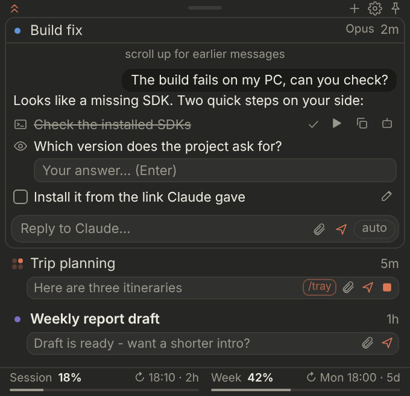
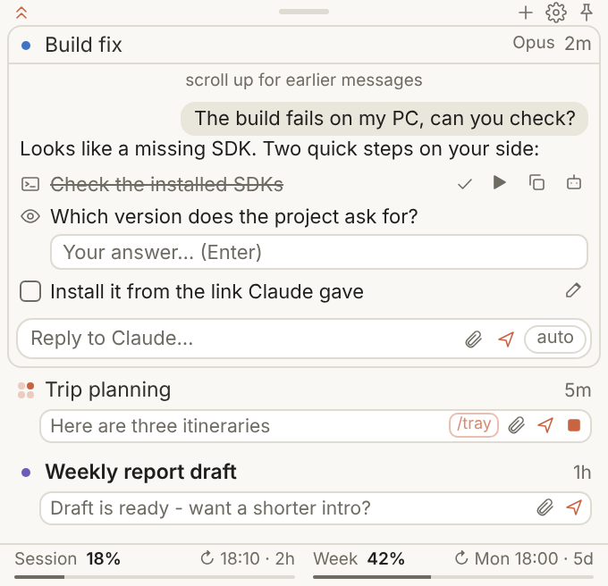
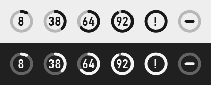

# Tray for Claude

Your Claude chats and plan usage in a small panel by the Windows clock: read, reply, stop, send files, and run the
steps Claude gives you in one click, without opening the app.

<p>
  
  
</p>



> **0.1.x - early preview.** It works, it has bugs, it changes often. Issues welcome.

- **Icon:** your usage as a ring (the limit you're closest to), plus dots when Claude is working, needs you, or has
  a new reply. Hover or click: the panel. Double-click: the Claude app.
- **Chats:** each tracked chat is one row with a one-line reply box. Click its title for the conversation, like the
  app: your messages, Claude's replies, its files (save / copy), the page's questions (Allow / Deny), stop, retry.
- **Steps:** in chats with `/tray`, Claude's PC steps come at the end of its reply: run (hidden, output captured),
  open, answer in one line, tick. "check" sends Claude the results - no pasting logs.
- **Yours to arrange:** pin, hide, sections, drag to reorder, sort by last used / name / project, browse claude.ai
  to bring any chat in, new chat (project, model). Resize and park the panel anywhere. Light / dark.

A single PowerShell script plus a page for the panel: no installer, no admin rights. Free software (MIT), no
warranty - see [Disclaimer](#disclaimer).

## Requirements

- Windows 10 (1809+) or Windows 11, with Microsoft Edge and the WebView2 runtime (both come with Windows)
- A paid Claude plan (Pro, Max, Team)
- Windows PowerShell 5.1 (built in)

## Install

1. Download this folder (or `git clone`) to a place you can write to, e.g. `C:\Tools\ClaudeTray`.
2. In PowerShell, in that folder:

   ```powershell
   powershell -NoProfile -ExecutionPolicy Bypass -File .\ClaudeTray.ps1 -WebLogin
   ```

   An Edge window opens on claude.ai: sign in, then close it. The icon appears by the clock (drag it out of the **^**
   area to keep it visible) and starts with Windows. That one sign-in gives both the usage and the chats.
3. Optional, for one-click steps: upload `skill/tray.zip` as a skill in Claude, set your shared folder with
   `.\ClaudeTray.ps1 -QuestRoot "C:\path\to\folder"`, and start a chat with `/tray` (the panel's `/tray` chip adds it
   for you). Without a connected folder Claude still works through the page ("bridge mode", see `docs/PROTOCOL.md`).

## Commands

| Command | What it does |
| --- | --- |
| `-WebLogin` | Sign the tray's own browser in to claude.ai (chats + usage), then start the tray. Start here. |
| *(none)* / `-Restart` | Start / restart the tray in the background. |
| `-Login` | Optional fallback for usage only, if the browser route doesn't work for you (Claude Code's sign-in). |
| `-QuestRoot <folder>` | The folder shared with Claude for steps and results. |
| `-Install` / `-Uninstall` | Add / remove the Start-menu and startup shortcuts. |
| `-Logout` | Delete the stored token and stop the tray. |
| `-Set key=value` | Change one setting in `config.json`. |
| `-Once` | One fetch, logs and preview images, then exit (troubleshooting). |

Run as `powershell -NoProfile -ExecutionPolicy Bypass -File .\ClaudeTray.ps1 <command>`.

## Privacy & security

**It talks to Anthropic only, over HTTPS.** No telemetry, no analytics, no third parties, no update checks.

| What | Where |
| --- | --- |
| Usage, every 3 min | `claude.ai`'s own usage page data, read by the tray's browser (fallback after `-Login`: `api.anthropic.com/api/oauth/usage`) |
| Chats | `claude.ai`, in the tray's own hidden Edge, signed in by you (`-WebLogin`) |

- **Token (only with `-Login`):** `oauth.json`, encrypted with Windows DPAPI for your account (useless elsewhere).
- **Chat browser:** a headless Edge with its own profile in `%LOCALAPPDATA%\ClaudeTray\browser-profile`, one hidden
  tab per tracked chat, driven over the DevTools protocol on `127.0.0.1` (random port). While it runs, another program
  on your PC that finds that port could use that signed-in browser, as with any browser in remote-debugging mode.
  It is closed on Exit / Log out / Uninstall. `engine: app` turns it off.
- **Local files:** `config.json` (settings), `state.json` (layout, pins, read marks), `logs\` (rotating log, no
  message text, no tokens, no chat titles, no user name; screenshots only with Debug logs or `screenshots: true`).
  All git-ignored. Uploads / downloads in temp folders are cleaned after a day.
- **Only your own chats, only when you use them:** the browser opens the chats you track, reads what the panel
  shows and types what you send - no crawling, no other accounts, no background requests beyond the usage check.
- **Steps run only when you click them.** A `url` step opens only web links, a `file` step never starts a program.
  Steps written in a reply count only in chats where `/tray` is on.

**Remove everything:** `-Uninstall`, `-Logout`, delete the folder and `%LOCALAPPDATA%\ClaudeTray`.

## Settings

Gear in the panel (or right-click it): theme, short replies from Claude, Debug logs, start with Windows / with the
Claude app / manually, reset size, sign in, folders, restart. More in `config.json` (see `config.example.json`):
`pollSeconds`, `questRoots`, `engine`, `panelWidth`, `panelZoom` (Ctrl+wheel), `usageAlerts`, `logMessages`,
`resultChars`, `sideWindows`, `ui` (`classic` = the old simple panel).

## Troubleshooting

- **Dash in the icon** - sign in: settings > Sign in to claude.ai (or `-WebLogin`).
- **"Live chats are off" / no conversation** - settings > Sign in to claude.ai.
- **"running scripts is disabled"** - use the full command with `-ExecutionPolicy Bypass` (applies to that run only).
- **Something's off** - Settings > Debug logs, reproduce, then look in `logs\claudetray.log` (or attach it to an issue
  - it contains no message text).

## Maintainers (human or AI)

[AGENTS.md](AGENTS.md): how it works, how to test without Windows, the PowerShell 5.1 traps already hit.
[CHANGELOG.md](CHANGELOG.md): versions. `docs/PROTOCOL.md`: the quest / results files. `docs/DESIGN.md`: UI decisions.

## Disclaimer

Unofficial, community-made. **Not affiliated with, authorized, or endorsed by Anthropic.** "Claude" and "Anthropic"
are trademarks of Anthropic; "for Claude" only says what it works with. It drives claude.ai in your own signed-in
browser and reads data that isn't a published API (the optional `-Login` fallback uses Claude Code's sign-in) - any of
it may stop working at any time. You use it at your own risk
and under your own agreement with Anthropic. Provided as-is under the MIT License - see [LICENSE](LICENSE).
